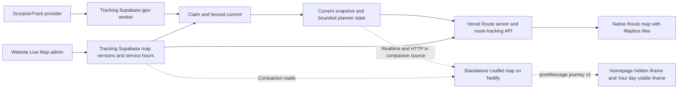

# Sightseeing Shkodra end-to-end audit

## Executive summary

1. **P1 · The former Live Map host is still a live dependency.** The standalone Netlify origin returned 404. The public homepage loads the same origin in a hidden iframe and shows “Tracking unavailable,” while its Route link opens a functioning native map. The still-reachable sample page at `/your-day` loads the dead iframe visibly. Both desktop and mobile reproduced the sample-page failure and the associated cross-origin console warning.
2. **P1 · Native tracking can get stuck after a map publish or failed initial load.** The browser binds itself to the map version it received on page load. When the API reports a newer version, the browser suppresses the vehicle and keeps the old geometry. A browser fixture reproduced the failure and absence of a recovery control. A failed initial map read can also prevent tracking polls from starting at all.
3. **P2 · The native map conflates off-hours and a tracking outage.** Production operating hours ended at 17:00 Shkodra time. At roughly 18:45, the native map showed a two-hour-old position and “Live updates are unavailable,” with no service-hours explanation. One stored fix took about 28.8 seconds from provider timestamp to worker receipt. That sample and the closed-hours window do not establish an active-service outage.
4. **P2 · Several controls promise effects their current consumers do not implement.** The Route editor still exposes presentation copy used by an older component. The live Route page consumes its SEO settings, while the current map uses its own headings. Published POIs survive the map projection and are filtered out of the native itinerary. The timetable link on the sample page points to a missing anchor. The seasonal notice has manually maintained departure and stop lists alongside operational sources.
5. **P2 · Audioguide has a plausible duplicate welcome path.** A passenger can autoplay an untriggered welcome when joining, and the operator can separately issue a welcome cue. Client deduplication protects repeated delivery of the same event. It cannot identify the uncued welcome as a previous play of a new manual event. The overlap is confirmed in source. A duplicate audible playback was not reproduced on a live tour.

## Scope and evidence

| Project | Source inspected | Environment verified |
|---|---|---|
| Main website | GitHub `main` at `8ebd55154df3304bdd5425542d471cce7099de2a`. Local working branch `work/mobile-hero-icons-20261116` at `a341a803a6bf2cdcddfc422cbfa6ce0bee6057a4` had pending work. Source references below use remote main. | Vercel Production, `www.sightseeingshkodra.com`. Production deployment for this commit was verified in the preceding release. This audit used public GETs and Chromium at 1440 and 390 px. |
| Standalone Live Map | GitHub `master` at `4f40c4988ba85a7189db159e3c47637b078b22e7`. Local `master` at `d56805d8ab42b4f844d09047d6eb91b574af1e60` was behind and modified. Source references use remote master. | Configured Netlify origin served “Site not found.” Its last historical release receipt names Netlify deployment `6af72ae72af613cf472fd5ef`. The separate production Supabase public project, latest snapshot and hours responded. The running worker bundle and scheduler were not independently attested. |
| Audioguide | Local and GitHub `main` at `6f2c884f0dbbb5f5f0d6a84eda23cace76244301`. | Cloudflare `sightseeingshkodra.app/health` returned 200 and `{"ok":true}`. Health does not identify the deployed commit or establish media or live-session parity. |

Live checks were on 27 November 2026 at approximately 18:42–18:46 Europe/Tirane. Local targeted tests passed: 51 Web App integration tests, 51 disposable database tests, seven selected Live Map worker/recovery/transport/hours/policy scripts, 30 Audioguide core tests and two Audioguide local Worker tests. Web App and Live Map local test results apply to the existing working files. Pinned remote source was inspected separately. A browser-intercepted test exercised the deployed website JavaScript with fictional tracking responses. Neither the fixture nor the browser offline checks wrote to a hosted service. Production admin checks were anonymous. Both internal worker routes returned 401 to an unauthenticated HEAD and no delivery worker was run. No administrator save, booking, cancellation, alert, email, Audioguide cue, provider credential lookup, or deployment was performed on production. The report records timing metadata for one latest GPS fix without retaining coordinates or a GPS history.

## Live Map integration

### Provider to screen

- **Ingest and continuity.** The processor requires an explicit vehicle and server authorization. It claims a database lease, reads the bound provider credential server-side, polls the provider, bounds the response and checks the configured tracker UID, time, coordinates, heading and speed. Source time and worker receipt time are distinct. Duplicate and older source times are dropped before deriving stop transitions, and the SQL commit independently checks monotonic time, revision, lease, map version and the bounded payload. The code uses one current fix and planner envelope per vehicle and upserts one public snapshot. A cold function instance reads that shared state. A runtime reset is a different event, with a source/revision floor and unknown continuity until a fresh guarded origin return. A stale duplicate cannot establish a new journey. Historical release notes identify a five-second scheduler, which was not rechecked on the hosted scheduler. The code can skip a cycle on lease contention, provider timeout, invalid or duplicate data, map-version change, and service closure. The handler collapses several upstream errors to a generic 503. `live-tracking-app/supabase/functions/gps-worker/handler.ts:3–24`, `engine.ts:3–25`, `supabase/migrations/001_tracking.sql:14–15,42–98`, `004_recovery_floor.sql`, `005_service_hours.sql:42–95`, `release/DEPLOYMENT-RECORD.md`.
- **Standalone source path.** It reads service hours before accessing the tracking feed. The configured client joins vehicle-filtered Supabase Realtime and also makes periodic HTTP reads at roughly five seconds while in use. Revision guards prevent late HTTP results or older events from reversing state. Per-browser, per-client entries deduplicate concurrent reads. HTTP aborts after ten seconds, failure backoff is bounded, and visibility, online and page lifecycle events clear subscriptions and cached state. The tourist model distinguishes moving, approaching, departing, parked, delayed, expired and closed. The source-time policy uses 90 seconds for live and a bounded historical window, exercised at the 600-second boundary in fixtures. The reported state and ETA are qualified separately. These are source and fixture observations because the Netlify page is down. `frontend/js/shared/app-config.js:20–22,50`, `frontend/js/shared/gps-source.js:21–99`, `frontend/js/live-map/track-bus.js:92,284`, `frontend/js/live-map/tourist-state.js:105–151`, `tests/test-tourist-policy.cjs`.
- **Native website path.** The Route server directly reads the selected public tracking project, its latest published map and default vehicle snapshot using the tracking project’s publishable configuration. Project lookup precedes parallel map and snapshot reads, with an eight-second shared deadline. The browser gets initial data and polls the Vercel endpoint every ten seconds while visible, with an immediate visibility refresh and a source-time expiry timer. There is no iframe or Realtime connection on `/route`. The endpoint returns an HTTP 200 with null fields on some upstream misses, and the browser deliberately keeps same-version historical context on failure. Native ETA requires a fresh position and matching project, vehicle, map version, source run, time and stop context. The native projection currently emits parked and en-route detail, and lacks the companion’s full presentation state set. Mapbox supplies tiles only. `src/app/(public)/route/page.tsx:20–40`, `src/modules/tracking/public-map-server.ts:8–59`, `src/app/api/public/route-tracking/route.ts:4–16`, `src/components/public/route-explorer.tsx:71–120`, `src/modules/tracking/native-journey.ts:25–68`, `src/components/public/route-explorer-map.tsx:53–96`.
- **Legacy iframe path.** The origin and project slug are pinned in `public-map-binding.ts:2–18`. The parent loads `live-map.html?project=sightseeing-shkodra&embed=1&websiteStatus=external-v1`, requests `shkodra:request-journey` v1, and accepts `shkodra:journey` v1 with embedded display from the bound frame window and exact origin. The companion checks the parent window and its origin allowlist, replies only to the verified origin, and accepts a validated stop-selection command. A legacy status message also exists on the companion. The website retries the handshake every three seconds until connected, expires data according to its presentation TTL, and resets on iframe load. The hidden homepage frame initializes near the route section and recreates on reconnect. The visible sample iframe offers Reload and a slow fallback. The iframe owns map markers and canvas, the parent presents the reported status and stop card, and the homepage’s editorial stops can render independently of the feed. In the desktop homepage warning, the recipient still reported the website origin while the parent targeted Netlify. This is consistent with an early handshake against the frame before it loads the expected origin. The returned 404 is an independent functional failure. Exact-origin checking should be retained for any supported embed. `src/components/public/live-map-embed.tsx:12–91`, `src/modules/tracking/journey-bridge.ts:4–45`, `src/components/public/homepage-journey.tsx:8–16`, `live-tracking-app/frontend/js/live-map/public-presentation.js:5–18,82–101`.

### Live observation window

| Surface | Desktop and mobile observation | Recovery or timing |
|---|---|---|
| Native `/route` | 200. Mapbox tiles loaded, no iframe, last-known marker and 16:52 Shkodra timestamp. No live badge or ETA for this fix. No cross-origin warning recorded. | Two API responses per viewport about 10.7 seconds apart. Browser offline then online with a simulated visibility event produced another successful response in the two-second observation period. The vehicle did not move in that window. |
| Standalone Netlify root and map | 404 and “Site not found.” | No map, update, or transport recovery to compare. Host requests took about 0.19–0.26 seconds. |
| Visible `/your-day` embed | Parent 200 and noindex. The same iframe returned 404 on both widths, emitted the target-origin mismatch warning and offered Reload map. | Retry cannot restore a retired origin. The parent page is explicitly a sample ticket. |
| Homepage route section | At 390 and 1440 px, approaching the section mounted the hidden iframe and received 404. Desktop also logged the target-origin warning. Public text showed “Live updates temporarily unavailable” and a planned next-stop fallback. | The Route link leads to the working native map. The homepage received no journey payload. |
| Tracking API and Supabase | Version 121. HTTP 200, no-store, CDN MISS and age zero. Public database snapshot revision 12175. Hours enabled every day from 08:45 to 17:00 Europe/Tirane. | API standalone GETs about 0.90–0.98 seconds. Latest source 16:52:29 local, worker receipt 16:52:57.823, public commit 16:52:57.879. Source-to-receipt 28.823 seconds and receipt-to-commit about 56 ms. The public read was about 113 minutes after source time. No live browser propagation or active-service loss can be inferred from this closed-hours sample. |

Browser-only fictional responses confirmed fresh parked copy, transition to last-known on delayed data, version mismatch suppressing tracking without a recovery control, and recovery when the API returned the original version. Companion fixtures exercised ordered/reordered observations, a hung request, reconnection, 90/600-second boundaries, transport failure, parking, and service-hour guards. A paired active-service test and a hosted scheduler receipt remain open.

### Configuration ownership

| Value | Authority and validation | Consumers and reach |
|---|---|---|
| Route geometry, stop IDs, names, coordinates, photos and sequence | Website Calendar → Live Map workspace delegates to tracking admin. It checks tracking access and uses `save_tracking_map` with expected head, published and draft IDs. `map_versions` published row is the public authority. | Native Route on reload, tracking worker, and standalone source on refresh if served. Draft is private. Existing native tabs fail to adopt a version change. `public/live-map-workspace/js/admin/admin-publishing-and-export.js:42–62,104–107`. |
| Points of interest | Same tracking editor and publication. Published map projection preserves active POIs. | Companion source can display map features. Native itinerary filters to stops, so POI edits have no visible native effect. `published-map.ts:32–52`, `route-itinerary.ts:35–54`. |
| Destination story, link, photo and stop association | Website → Stops & destinations. Separate editorial entities join on tracking stop ID. Operational stops are displayed for association review. | Homepage and Explore own editorial display. Native Route can use the linked name, text and photo fallback while geometry stays in tracking. `src/app/admin/route-stops-panel.tsx:7–16`, `route-itinerary.ts:35–53`, `route-explorer.tsx:225–240`. |
| Boarding point | Calendar booking meeting point via `saveMeetingPoint`, with configured URL and possible map stop association. `routeBoarding` has an explicit known short-link mapping and prefers verified pickup coordinates. | Booking instructions and native boarding pin. Companion operational origin is separately derived from published map order. A scheduled tour can intentionally keep its configured pickup even when Find me recommends the nearest mapped stop. `meeting-point-actions.ts:6–14`, `route-itinerary.ts:73–122`. |
| Service hours | Tracking `vehicle_service_hours`, `save_vehicle_service_hours`; worker checks at claim and commit. | Companion and Calendar GPS warning consume the window. Native passenger Route omits it despite reading the same project. Booking departure time and cutoff are separate concepts. `005_service_hours.sql:30–40,64–95`, `public/live-map-workspace/js/admin/admin-service-hours.js:16`, `src/app/admin/calendar-panel.tsx:24–30`, `public-map-server.ts:21,40–56`. |
| GPS freshness, parked, next stop and ETA | ScorpionTrack sample time plus versioned database planner state. Browser consumers apply their own freshness and confidence policy. | Native Route guards live at 90 seconds and accepts last-known with no maximum age. Companion has richer states and bounded retention. A common policy or explicit documented difference is needed. `route-itinerary.ts:11–32`, `native-journey.ts:25–68`, companion `tourist-state.js:105–151`. |
| Tracking deployment and tile provider | Tracking worker and database are separate from the frontend. Vercel Production provides the public Mapbox token. Companion embed host and project are code constants. | Switching tiles cannot fix GPS latency. Production native map works independently of the disabled Netlify frontend. `public-map-binding.ts:2–18`, `route-explorer-map.tsx:53–96`. |

## Admin-to-public matrix

**Source** maps the current implementation. **Live** identifies public reads. **Fixture** identifies a local automated or intercepted test. No current production save-to-screen mutation was performed.

| Setting or flow | Validation, storage and publication | Destination and verification |
|---|---|---|
| Website content, navigation, FAQ, contact and legal | Section whitelist and operator/role checks, schema validation, optimistic timestamp and `save_website_content_v1`. Draft and published body are distinct. Publish updates the cache tag, with a 60-second fallback revalidation on public reads. | Header, footer, homepage, FAQ and published legal pages read snapshot. Live pages loaded. Publication, missing configuration and fallback covered in fixtures. Website language is an English indicator without a locale control. Audioguide languages are separate. `website-actions.ts:10–33`, `website-server.ts:11–55`, `booking.tsx:503–508`. |
| Route editorial and SEO | Same website publication. `routePage.*` presentation and SEO fields coexist. | Native metadata reads SEO keys. Native body uses route name and component labels. Older `RouteJourney` is still used in admin preview. Six Route presentation fields can save and preview without changing the public map. Source confirmed, live title checked. `editorial-fields.ts:6,16`, `route/page.tsx:15–40`, `route-journey.tsx:29–34`, `admin/[operatorId]/website-preview/page.tsx:39`. |
| Departures visibility and links | Website visibility schema describes a Route timetable toggle and guards certain links with the stored `departures.showOnHomepage` key. | Native Route always exposes Departures through its Stops panel and has no `#journey-departures` target. Sample page still links to that fragment. Source confirmed and live anchor count zero. `website-schema.ts:16–25`, `your-day/page.tsx:57–61`, `route-explorer.tsx:246–273`. |
| Homepage SEO and language | Homepage SEO title/description use published content. Social image prefers the hero image. Standalone image/alt are compatible stored fallbacks excluded from active global editor. Canonical/indexing also depend on deployment configuration. | Home metadata and sitemap/robots. Live robots and sitemap 200, private/support routes returned noindex where expected. Keep compatibility fallback, do not treat it as an active duplicate editor. `website-schema.ts:111,120`, `seo.ts:2,105–125`, `src/app/{robots,sitemap}.ts`. |
| Seasonal notice | CMS validates inclusive Tirane dates and text. Departure times, photo stops and service copy are editable strings. | Live winter ribbon displayed on Route. Live Day Planner returned 09:00, 11:00, 13:00 for the active Panorama product. Independently entered time and stop strings can become stale when operations change. No conflicting actual time was demonstrated. `seasonal-announcement.ts:4–27`, `day-planner-server.ts:7–27`, public layout. |
| Product cards and direct links | Card presentation comes from product card and Website content, including primary-card fallback to hero image/copy. Product ordering and activation have operator-scoped actions. | Homepage, Book section and direct product selection. Live `/book` 200, targeted direct-product tests passed. A default homepage card can look different from its explicit product card when no card exists. `homepage-view.tsx:36–45`, `products-actions.ts:6–41`, `src/app/(public)/book/page.tsx:14`. |
| Tours, schedules, capacity, prices and cutoffs | Product workspace saves activation, availability, inventory source and reservation mode. Calendar writes date overrides and passenger prices, with server confirmation for closure. Day Planner follows the active product to its inventory and effective schedule RPC. The booking API performs availability and holds independently. | Route timetable is scheduled service, not a seat guarantee. Booking validates live availability, fare, capacity and cutoff. Live Day Planner confirmed the active product and times. Disposable database tests verified date exceptions, product activation, prices, hold guards and rollback of unsafe edits. A hosted multi-client availability and capacity check still needs staged writes. `products-actions.ts:6–31`, `product-booking-actions.ts:5–14`, `calendar-actions.ts:6–17`, `day-planner-server.ts:12–27`, `src/app/api/public/checkout/route.ts:29,121,181`. |
| Booking creation and staff visibility | Checkout coordinates session-scoped holds and orders. Staff creates through operator-scoped transactional booking RPCs. Public and staff booking sources feed operational booking records. | Admin Bookings and Departures are the investigation entry points by booking reference. No production booking was placed or customer data accessed. Verify public and staff transitions against a staged booking record. `checkout/route.ts:72–85,121,181`, `orders-server.ts:134`, `staff-booking-server.ts:8`, `booking-actions.ts:22–51`. |
| Modification, cancellation and QR | Private customer token and same-origin POST route, server RPC dispatch, request ID/version/expected total on modification. Staff pass lookup/check-in is operator scoped. Cancellations retain the booking record and QR history. | Live public management shell loaded without a token. QR integration and disposable database tests covered customer changes, cancellation and pass handling. Preserve issued URLs and verify the full staged browser workflow. `src/app/api/public/booking-management/route.ts:2–11`, `customer-management-server.ts:5–22`, `pass-server.ts:7`, `booking-record.tsx:23`, `booking-actions.ts:54–75,143–171`. |
| Email, alerts and notifications | Booking domain events and delivery queues provide idempotency; booking resend is a distinct manual action. Authorized worker endpoints and webhook process deliveries. Booking alerts feature gates and device settings are separate from transactional confirmations. | Email admin delivery history vs staff notification center and bell. Notification and disposable delivery-queue tests passed, including independent retry and avoiding duplicate send on an expired sender lease. Current hosted scheduler, inbox delivery, device permissions and duplicate delivery were not observed. `booking-actions.ts:9–19`, `api/internal/booking-emails/route.ts:5–8`, `api/webhooks/resend/route.ts`, `20260925000100_resend_booking_emails.sql:36–74`, `20261005000100_admin_notifications.sql:94–106`. |
| Live Map routes, stops, POIs and hours | Tracking editor and published map versions, with service hours stored separately. See ownership table. | Live geometry and last-known marker, version change reproduced with browser fixture. POI and service-hours reach gaps confirmed in source. |
| Audioguide QR and active/new sessions | Boarding route binds access to vehicle and departure. Vehicle Durable Object reserves one session for a start request and pins the published route version. Passenger accesses only the pinned manifest and media. Draft and published versions are separate. | Source and local Worker tests verified idempotent starts, a new published version during a running tour, the original version’s media, restart recovery, and a fixed QR’s departure scope. New departures use the new published version. An already-running departure retains pinned media. Reopening a passenger may fetch updated global language order, flags and removal preferences against the pinned recordings. Health only was tested live. `apps/worker/src/index.ts:100–124,164–173,236–253,264–314`, `live.ts:84–135,254–260`. |
| Audioguide language, audio, music, announcements and GPS | Published version ties available recordings and triggers to POIs. The Audioguide Worker receives its own tracker feed and forwards accepted fixes to the vehicle/session, evaluates direction and route order, and dispatches scoped WebSocket events. This is a separate path from the public map’s ScorpionTrack polling. Passenger filters languages to playable recordings and handles mute, ducking, autoplay and cue deduplication. | Browser permissions and deliberate replay are separate from retry. Core tests covered invalid/late fixes and trigger rules. The local Worker integration exercised Traccar-format fixes, listener isolation and reconnect. No production active session, audio playback or GPS-trigger delay was verified. `live.ts:246–318`, `apps/web/src/index.ts:433–568,811–870,943–951,1058–1062,1127–1130`, `played-cues.ts:5–30`. |

## Duplicates and legacy candidates

| Candidate | Evidence and ownership | Disposition and compatibility |
|---|---|---|
| Homepage background feed, sample iframe and native Route | Two distinct tracking presentation stacks. Live homepage and sample fail through the fixed host. Native Route reads the same backend independently. | **Consolidate, high confidence.** Main site should consume a normalized native read model. Keep the companion code and backend until external embed and direct link consumers are inventoried. |
| Route CMS presentation copy, old RouteJourney and timetable hash | Editor and sample still reference former layout. Native public route uses separate controls. Admin preview intentionally disables actual map. | **Consolidate, high confidence.** Preview the real visitor structure or retire the unused editor fields while retaining storage compatibility. Restore meaningful landing behavior for existing timetable fragments or update internal links and keep an alias. |
| Sample `/your-day` | Live 200/noindex with sample QR, duplicate tracking CTA and dead iframe. Repository search found no current internal link to this route outside its own definition and route metadata. | **Deprecate, medium confidence.** First replace dead iframe with native Route link. Verify inbound links, analytics and issued email/QR destinations before a redirect or retirement. |
| Global New booking link and Bookings creation form | Admin header opens `/bookings?create=1#new-booking`. Actual creation uses Bookings server actions. `admin-shell.tsx:47`, `booking-actions.ts:22–51`. | **Keep.** Shared handler and useful operations shortcut. Test both entries resolve to one form and one action. |
| Calendar/More links, tracking workspace and Stops & destinations | Calendar GPS warning and booking setup shortcuts link to owners. Website destination editor joins read-only operational stop associations. `calendar-panel.tsx:24–30`, `more-panel.tsx:10–12`, `route-stops-panel.tsx:7–16`. | **Keep ownership split.** Prefer labels that distinguish operational stops, pickup and website destination descriptions. |
| Booking email page and notifications center | Email page title “Email & Notifications” overlaps staff alert naming. Email controls sender/delivery diagnostics, alert center controls recent alerts and this device. Manual resend is attached to the booking record. | **Consolidate labels, keep distinct actions.** Rename the email screen to match More’s “Booking email delivery.” Preserve record resend and permission boundaries. `admin/[operatorId]/(workspace)/email/page.tsx:4`, `email-panel.tsx:19–26,67`, `notifications.tsx:67–70`, `bookings-panel.tsx:191`. |
| Seasonal times and stops | Website popup holds manual strings while Schedule and Live Map publish operational data. | **Consolidate where facts are intended to match, medium confidence.** Keep an explicitly editorial notice when it describes a future season or different itinerary. |
| Audioguide auto welcome and operator Welcome | Passenger joins at sequence zero and can autoplay a welcome. Operator button sends `manual play` for first announcement. Reconnect dedup keys by cue identity, while the auto path has no cue. `apps/web/src/index.ts:943–951`, `operator.ts:243–249`, `played-cues.ts:5–30`. | **Investigate duplicate playback.** Test automatic welcome followed by manual Welcome, reconnect and explicit Replay in isolated staging. Pick one default owner while preserving staff replay. |
| Earlier tracking `SharedMap`, old position reader, `LiveView`, preview routes and companion archives | SharedMap has a dev consumer. `LiveView` is used by the CMS fixture. `/dev/live-map-preview` returned 404 in production. Companion archive is historical release evidence. `src/modules/tracking/README.md`, `src/app/dev/tracking-preview/preview.tsx:22`, `src/app/dev/cms-reconciliation/page.tsx:6`. | **Deprecate or remove proven-unused reader only after import, build and fixture checks.** Keep fixtures that establish contracts or port parity. Keep release artifacts needed for rollback. |
| `/live` redirect, booking/pass links, worker/webhook routes, Audioguide GPS test | `/live` returned 308 to native Route. Booking tokens, provider callbacks and audio QR/media versions can be used without navigation. Audioguide registers its GPS test route and Worker cron in current source. | **Keep redirects and issued contracts. Investigate support tools.** Verify real scan and management links, scheduler definitions and webhook registration before any removal. Audit mode authorized no retirement. |

## Prioritized fix plan

| Priority | Smallest justified change | Acceptance before deployment |
|---|---|---|
| 1 | In `homepage-journey.tsx`, replace the dead hidden iframe with a shared native status read or remove live-status framing and link to Route until the read is ready. In `your-day/page.tsx`, replace the dead iframe with the native map link and repair timetable targeting. Keep `/live` redirect. | Both widths show no request to the dead origin, no target-origin warning, and working Route navigation. Homepage retains useful stop context in outages. Validate direct and issued link analytics before deprecating the sample route or bridge. |
| 2 | In `route-explorer.tsx` and `route-tracking/route.ts`, treat version changes and initial unavailability as recoverable. A clear Retry action that refreshes the server payload is the smallest recovery. For automatic adoption, reload geometry and status as a coherent version and preserve the visitor’s map-view intent. | Stage first-load failure then recovery, version N to N+1 mid-session, node or provider outage, same-version status expiry, and browser reconnection. Never render a new stop state on old geometry. |
| 3 | Extend the native reader’s existing service-hours option into passenger status, and decide a bounded last-seen display and camera policy. Keep source time, reported time and transport failure distinct. Add coarse aggregate timing and reason metrics at the worker/API boundary without storing GPS history or request payloads. | Stage open/moving, parked, closed, overnight boundary, lost/old provider data and transport failure. Measure source → worker receipt → commit → API → visible marker on an actual open-hours run. Confirm scheduler cadence and deployed worker identity from read-only logs. |
| 4 | Reconcile Route editor and preview with native consumers, settle which POIs belong publicly, clarify calendar versus notice ownership, and repair links and labels. | One staged save/publish/rollback round for map geometry, stops, hours, one POI, Route copy and SEO, seasonal schedule copy, product activation and calendar settings. Document where tabs refresh and where a draft remains private. |
| 5 | Run staged booking and Audioguide lifecycle tests. Cover checkout retry, concurrent last seats, modify, cancel, QR scan, one confirmation and alert, and no unintended delivery. For Audio, publish version B during a version A departure, issue welcome/replay, change language preferences, reconnect and verify old QR/media compatibility. | Verify booking count and inventory in admin, idempotent queues and inbox on isolated recipients, and one cue per intended action on physical iOS/Android where possible. Test new versus active sessions separately. |
| 6 | Retire only candidates with consumer evidence and controlled rollback. | Check route/redirect logs, dynamic and fixture imports, database grants, migration dependencies, schedules, webhooks, and already-issued tokens or QR links. Record external owners before deleting any contract. |

Restoring the existing Netlify frontend is the smallest change **if an external standalone map or embed is still required**. It would recover old URLs and the original live presentation after a hosted parity test. It also keeps two independently deployed UIs and an origin-sensitive bridge. For the website itself, using the existing native Vercel presentation and common tracking read model removes the dead frontend dependency without adding a second GPS worker, changing the scheduler, or storing new data. It takes frontend work to match the useful companion states and publication recovery. A more elaborate realtime or hosting migration is premature until open-hours measurements show how much delay polling actually contributes and an external-consumer inventory establishes a reason for it.
