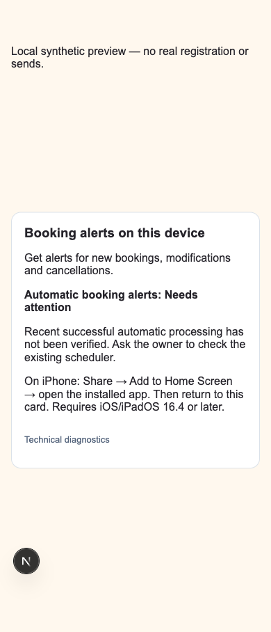
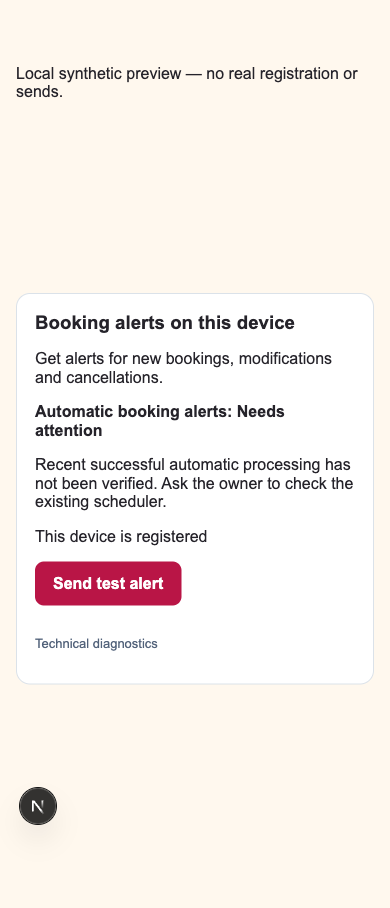

# Booking alerts — concrete local release candidate, 7 November 2026

> Latest release verdict, exact notification-only artifact and rollback plan: [deployment readiness review](NOTIFICATION-DEPLOYMENT-READINESS-2026-11-07.md). Earlier test counts and acceptance statements below describe their original stage.
Canonical admin origin: **https://www.sightseeingshkodra.com**. Local branch `work/email-com-simple-alerts-20261107`; no publication, hosted environment/DNS/schedule/key change, real sends or customer bookings. This report supersedes setup and acceptance guidance in ADMIN-BOOKING-ALERTS-2026-11-07.md and EMAIL-COM-SIMPLE-ALERTS-2026-11-07.md. Their original observations remain historical evidence. Existing product work and independent Live Map preserved. The documented canonical folder remains absent; current previously authorized repository used, no additional clone/worktree.

## Confirmed production observations

Authenticated read-only dashboard/SQL inspection on 7 November, approximately 17:18 UTC, plus fresh production Email screen reload:

| Item | Actual evidence |
| --- | --- |
| Runtime sender | **tickets@sightseeingshkodra.app**, still shown after reload; verified .com has not switched the deployed sender |
| Desired sender | `Sightseeing Shkodra <tickets@sightseeingshkodra.com>`; .com Verified in the connected Resend dashboard. Fresh acceptance with this From/key remains untested |
| Reply-To/admin recipient | Existing Gmail business mailbox; no change required to make the visible From .com |
| Domain routing | Vercel: apex .com → www.com 308; www.com and .app both Production. Public manifest/worker audit agrees |
| Auth | Supabase Site URL remains https://sightseeingshkodra.app; five allowlist entries, including .app/auth/activate and Vercel patterns, **no .com/auth/activate** |
| Public site environment | NEXT_PUBLIC_SITE_URL exists for Production; revealing its exact value requires Vercel email-code verification. Cancelled the verification prompt; no code sent. Do not conflate Supabase Site URL with this application variable |
| Hosting | Vercel team shows **Hobby**; Supabase organization shows Pro |
| Processing flags | Email screen Enabled/Ready, activation configured. Fresh HTTP worker bodies `live` and `push` establish effective live email/background/projector/push configuration and valid activation boundaries. Exact environment timestamp values were not exposed, copied or changed |

The latest inspected owner/customer pair (13:27 local) was accepted and delivered to receiving servers using .app. Earlier cancellations also have delivered outcomes; there are no real modification-delivery records. The eleven recorded provider failures/suppressions/complaints are historical, not eleven new domain failures. .com DKIM and delegated SPF/bounce routing are verified; no .com DMARC TXT resolved. Received MIME headers were unavailable. Return-Path is provider SMTP routing, distinct from visible From and Reply-To; actual .com alignment, inbox placement and audible alerts remain unverified. DNS verification is not delivery evidence.

## Automatic delivery: resolved findings

**No current scheduler/queue processing blocker was observed.** One existing Supabase Cron job, `sightseeing-booking-notifications`, active `* * * * *`, invokes both `/api/internal/booking-emails` and `/api/internal/admin-notifications` at https://sightseeingshkodra.app. No job was invoked manually or altered.

- Last 24 hours: **1,440 succeeded scheduler runs**, no failed runs in that window. SQL completion alone is not HTTP success: inspected pg_net responses separately.
- Last ten minutes: **20 HTTP 200 responses**; ten body status `live` (email), ten `push` (notifications), latest 17:18 UTC. No disabled body or HTTP failure observed in this window. This is recent operational evidence, not a promise of future execution.
- Email heartbeat: `live`, started 17:18:00.434 UTC, last success 17:18:01.931 UTC.
- Email queue: 54 accepted, no pending/retry/leased/sending/failed/uncertain rows. **Zero stale email leases**. Provider bounces/suppressions are outcomes associated with previously accepted rows, not worker-queue failures.
- Push queue: 19 accepted, no pending/sending/failed/uncertain rows; latest accepted entry 12:27 UTC. One enabled device. Accepted push is transport acceptance, not proof of physical display.

The existing external scheduler is operating; Vercel's built-in Hobby cron restriction must not be misreported as its observed failure. Official Vercel legacy cron limits permit Hobby once daily and Pro once per minute. The existing requests use normal function execution limits. Hobby is also restricted to personal/non-commercial use, so eligibility for this commercial booking site still needs an owner/provider decision. No new scheduler, unsupported Vercel minute cron, plan upgrade or workaround was added. Preserve the single existing job while deciding eligibility; do not activate a second job. See [Vercel cron limits](https://vercel.com/docs/cron-jobs/usage-and-pricing) and [Hobby eligibility](https://vercel.com/docs/plans/hobby).

## Final local changes

Earlier email importance/reference headers, immutable-envelope marker, lease/idempotency, event queues, private push text, authenticated click fallback, VAPID validation and registration repairs are preserved. Fresh owner and customer email paths all consume the configured sender; example binding uses tickets@.com and the live admin status warns on a different domain. No forced override of working configuration or historical envelope. Newly prepared owner links and staff recovery use canonical www.com; customer booking-management URLs keep their existing site binding. New .com installations resolve the relative push booking URL on .com. Legacy .app admin/auth GETs redirect to canonical preserving booking query and safe login return path; public/customer URLs, worker bootstrap assets, API and POSTs are unaffected.

Manifest `/admin` identity, start URL/scope, standalone display and worker `/admin/sw.js` + `/admin/` scope remain unchanged and resolve on www.com for new installations. Retaining relative identity avoids invalidating working apps. Existing .app installations remain separate permissions and subscriptions, not transferred devices. No push key rotation.

One **Booking alerts on this device** card now shows install guidance, Enable, or **This device is registered** + **Send test alert**, after persistence verification. Saved push preferences are preserved; absent preferences default all three booking events on. Registration no longer silently opts users back into events they disabled. Diagnostics/repair/device management stay collapsed. Recovery covers blocked permission, failed registration and expired sessions. Test acceptance is explicitly distinct from display/sound.

**Automatic booking alerts: Active / Paused / Needs attention** appears separately. Active requires configured/enabled push, valid current activation boundary, a successful push worker heartbeat within three minutes and no detected overdue or recent failed/uncertain queue. Paused reflects disabled delivery. Absent/missing migration, unreadable/stale/failed heartbeat, invalid configuration or queue issues show Needs attention. Successful registration or a test does not update this heartbeat. This is push-processing health; separate Email delivery screen retains email heartbeat/outcomes. Refresh/focus/settings reload reads health; no second polling or scheduling architecture.

New migration `20261107000200_admin_push_worker_health.sql` creates one service-only operational status row per operator, without endpoints or payloads. Worker start/finish tokens prevent an older concurrent run overwriting a newer one. Best-effort heartbeat storage cannot block queue processing; an unreadable/missing status cannot produce Active. Before applying this migration the new screen safely shows Needs attention. Existing queues/booking schema remain unchanged. This migration is **local and unapplied hosted**; earlier product migration is separate scope.

## Screenshots and verification

Actual local component with browser APIs mocked; no real subscription/provider. Diagnostics closed, no horizontal overflow at 390, 768, 1440; blocked/install/registered/ready states checked. These are Chromium synthetic views, not physical Safari acceptance.

Additional screenshots: evidence/notification-release-20261107/{ready-390,denied-390,registered-768,ready-1440}.png.

Full npm test: **703 passed, zero failed**: 177 component, 24 identity, 247 integration, 220 database, 28 PostgreSQL, 7 CMS verification. npm run check (lint, route generation/TypeScript, normal optimized production build) and git diff --check pass. Core schema inventory updated for the additive heartbeat table; RLS/service-only access and stale-token behavior tested. Final enhanced event test passed separately after adding explicit old-installation revocation coverage.

Real disposable SQL creation/modification/cancellation each independently produces exactly one admin and one customer email through fake providers, .com From, .com admin links, preserved .app customer links, admin-only importance headers and correct booking references. Each event delivers once per enabled authorized device; replay does not duplicate. Explicitly disabled old installation receives no fanout while other devices remain enabled. Separate email/push failures do not block the other channel or undo confirmed bookings. Existing frozen retry, click, authenticated-return allowlist, denied/unsupported/session, persistence, expiry, repeated-login/subscription reuse and rate-limit tests remain included. Health tests reject flags-only, stale/future/missing/failing/unreadable evidence.

Evidence: evidence/notification-release-20261107/{tests.log,check.log,events-health-tests.log,final-event-test.log,public-origin-dns.json,production-observations.json}. No screenshots of customer data or secrets retained.

## Exact release checklist — approval still required

1. **Plan/processing decision:** confirm commercially eligible Vercel hosting with the owner/provider. Preserve the existing single Supabase job and current enabled flags/start timestamps. No automatic pause/activation or plan change is included in this release. Do not replace it with unsupported Hobby minute cron.
2. **Sender change:** after approval set Production RESEND_FROM_EMAIL to `Sightseeing Shkodra <tickets@sightseeingshkodra.com>`, confirm the existing production key authorizes the verified domain, and redeploy with that setting. Preserve Reply-To/admin recipient. Do not alter frozen prepared jobs or reset idempotency/retry states. Inspect pending jobs again at cutover; this audit found none. New sender configuration, not local code alone, effects the change.
3. **Auth:** add exact `https://www.sightseeingshkodra.com/auth/activate` to Supabase redirect allowlist. Review changing Supabase default Site URL to canonical www.com for staff auth templates/fallbacks; retain existing working .app callback during transition. Verify actual Production NEXT_PUBLIC_SITE_URL with owner verification, and preserve it for existing customer links unless a separate customer-origin transition is approved. Do not indiscriminately replace customer URL configuration.
4. **Database + source:** apply only the reviewed heartbeat migration for this notification revision, then release the selected notification source. Separately decide inclusion of the earlier product-controls migration/source; shared dirty worktree is not a release manifest. Recheck branch, remote, exact diff, CI and Vercel behavior before any push/merge. No publication is authorized by this checklist.
5. **Scheduler canonical target:** if consolidating internal calls to www.com, update the URLs in the **same existing job**, retaining its frequency and private authorization. Existing .app API currently works and is deliberately excluded from admin GET redirects; this URL change is not required to repair a current outage. Verify both worker HTTP bodies afterward and ensure exactly one scheduler remains. Never expose the authorization header or copy it into evidence.
6. **Migrate one phone at a time:** in Other notification preferences and devices, disable the former registration for that phone before enabling its new www.com installation. If the old app has already redirected, revoke its known device entry from canonical admin. Keep unrelated authorized devices enabled. The browser provides no trustworthy cross-origin hardware identity: automatic deduplication of two independently registered origins is impossible. Do not assume logging out or deleting an icon revokes a server endpoint. If the former entry cannot be identified, resolve it with the owner before enabling the replacement. Existing per-endpoint uniqueness/repair retirement does not merge different origins.
7. **Controlled email acceptance:** use the configured-admin-only **Test delivery to admin** action. It creates no booking and contacts no customer. Record provider ID, separately verify acceptance, receiving-server delivered event, original From/Reply-To/Return-Path/Authentication-Results and inbox/spam placement. No .com test was sent here; inbox/headers remain pending. Do not change DNS/DMARC until all legitimate senders are reviewed and explicitly approved.
8. **Physical iPhone acceptance:** iOS/iPadOS16.4+, Safari → https://www.sightseeingshkodra.com/admin → sign in → Share → Add to Home Screen → open that installed icon. Open Booking alerts on this device, tap Enable booking alerts → Allow, expect This device is registered. Tap Send test alert; confirm visible receipt, repeat after cooldown while backgrounded/locked, then test tap/login/correct booking. Missing automatic health evidence must remain Needs attention, not be dismissed by test success. Earlier iPhone Mirroring attempt timed out; no physical acceptance is claimed.
9. **Real event acceptance:** owner participation using approved operational bookings is still required for new/modified/cancelled live email and push independently. Do not fabricate customers, place fake public bookings or resend historical uncertain mail. Observe queue/heartbeat/provider/device evidence and verify the retired old installation stays silent. Local SQL/fake-provider tests do not establish actual APNs, inbox or iPhone sound.

For sound, allow the installed app under Settings → Notifications, Lock Screen and Sounds, and review Focus/Silent mode/volume. Mail needs the receiving account's Alerts/Sounds and appropriate fetch or push settings; Gmail/Outlook apps have separate account controls. Importance headers cannot force sound or bypass Focus. Official [WebKit Home Screen/tap requirement](https://webkit.org/blog/13878/) and [Apple push guidance](https://developer.apple.com/documentation/usernotifications/sending-web-push-notifications-in-web-apps-and-browsers) checked this turn.
